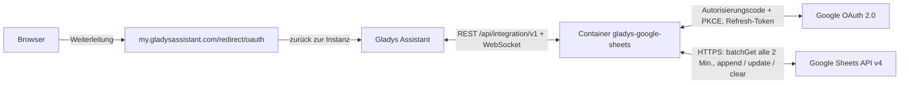
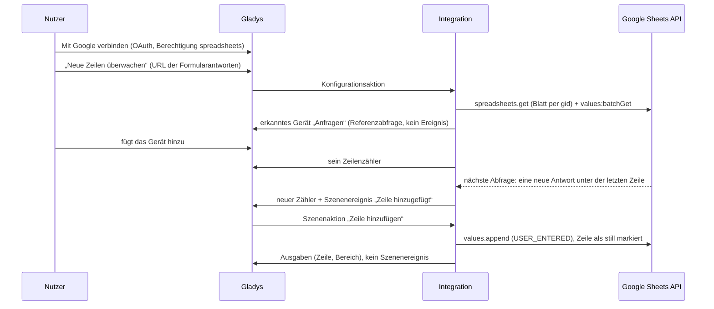
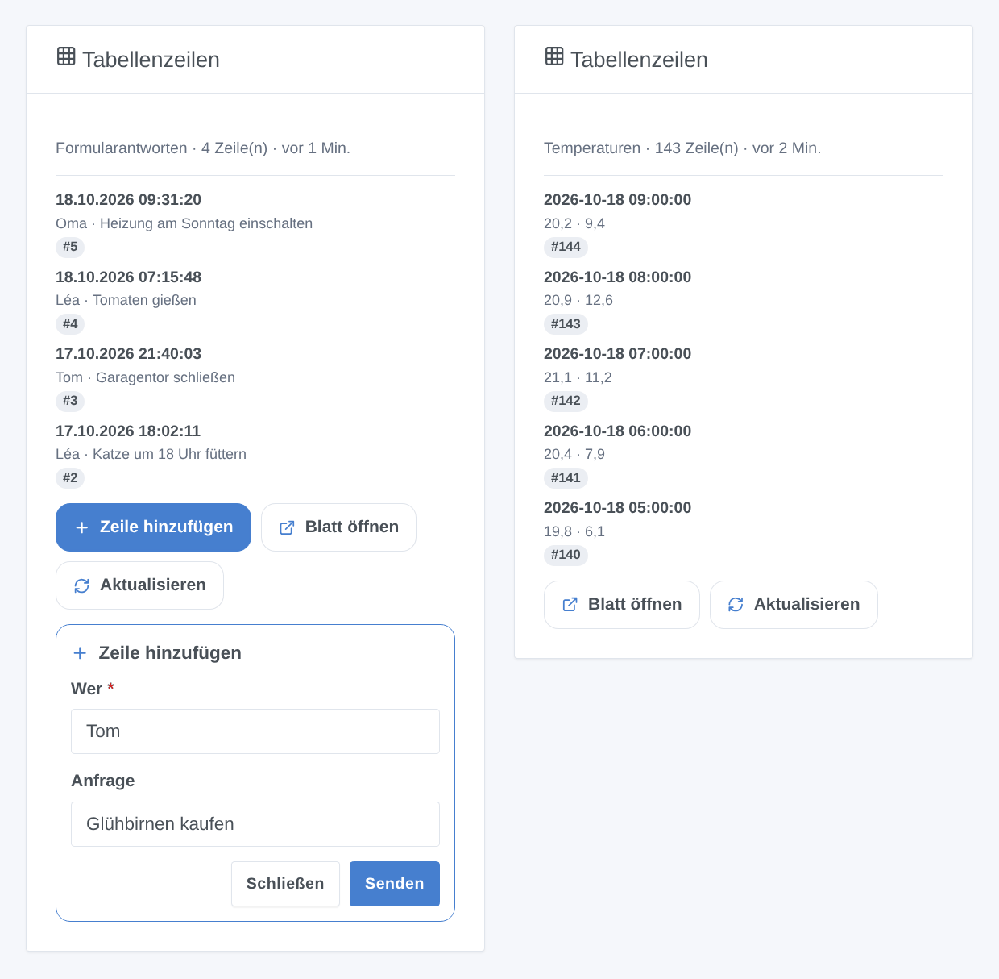

# Gladys Google Sheets

[English](README.md) · [Français](README.fr.md) · **Deutsch** · [Español](README.es.md)

[](LICENSE)
[](https://github.com/William-De71/gladys-google-sheets/releases)
[](https://github.com/William-De71/gladys-google-sheets/actions/workflows/release.yml)
[](https://gladysassistant.com)


Externe [Gladys-Assistant](https://gladysassistant.com)-Integration für **Google Sheets**: Deine Szenen fügen Zeilen hinzu, schreiben, lesen und leeren Zellen deiner Tabellen, und Gladys reagiert auf das, was sich darin ändert (eine Google-Forms-Antwort, ein am Handy eingetippter Wert). Überwachte Zellen werden zu Geräten, und ein Dashboard-Widget zeigt die letzten Zeilen eines Tabellenblatts mit einem Formular zum Hinzufügen; sie nutzt die offizielle Google Sheets API mit deinem eigenen Google-Cloud-OAuth-Client.

Benutzerdokumentation: [English](docs/en.md) · [Français](docs/fr.md) · [Deutsch](docs/de.md) · [Español](docs/es.md).

> Community-Integration, weder mit Google verbunden noch von Google unterstützt.

## Funktionen

- **4 Szenenaktionen**: Zeile hinzufügen (auf Wunsch mit Zeitstempel), Zellen schreiben, Zellen lesen (angezeigter Wert, tatsächliche Zahl, ganzer Bereich), Zellen leeren, in jeder Tabelle, die das Konto bearbeiten darf.
- **Überwachungen**, im Konfigurationsbildschirm ohne JSON angelegt, eine eingefügte URL genügt: eine **Zelle** (ein Gerät: Zahl, Text, Temperatur, Betrag oder Energiezählerstand) oder die **neuen Zeilen** eines Tabellenblatts (ein Gerät: Zeilenzähler).
- **2 Szenenauslöser**: **Zelle geändert** (Filter auf den neuen Wert) und **Zeile hinzugefügt**, nie ausgelöst durch Änderungen von Gladys selbst.
- **1 Dashboard-Widget**: die letzten Zeilen eines überwachten Tabellenblatts, mit einem Formular „Zeile hinzufügen“ nach den Namen der Kopfzeile.
- **OAuth 2.0** mit deinem eigenen Google-Cloud-Client: nur die Berechtigung `spreadsheets` (kein Drive), PKCE, Status bleibt über einen Neustart erhalten, ein widerrufener Zugriff wird gemeldet, ohne Google zu überlasten.
- **Kontingentschonend**: eine gebündelte Abfrage pro Tabelle standardmäßig alle 2 Minuten, ein lokales Limit unter den 60 Anfragen pro Minute von Google, exponentielles Warten bei HTTP 429.
- Vier Sprachen überall: Englisch, Französisch, Deutsch, Spanisch.

Im Vergleich zur Home-Assistant-Integration `google_sheets`, die nur aus einer Automatisierung Zeilen anhängt, liest, schreibt und leert diese auch Zellen, reagiert auf neue Zeilen und geänderte Zellen und stellt Zellen als Geräte bereit.

## Funktionsweise






### Transport

`transports: ["cloud"]`: Alles läuft über die Google-Server; deine Daten fließen nur zwischen Google und deinem Gladys. Die Geräte der Überwachungen tragen das Cloud-Abzeichen und ein „nicht erreichbar“-Abzeichen, sobald Google den Zugriff widerrufen hat oder die überwachte Tabelle bzw. das Blatt nicht mehr lesbar ist.

## Geräte und Funktionen

| Überwachung | Funktion | Kategorie / Typ                                                                                                                                      |
| ----------- | -------- | ---------------------------------------------------------------------------------------------------------------------------------------------------- |
| Eine Zelle  | Wert     | `unknown` / `unknown` (Zahl), `text` / `text`, `temperature-sensor` / `decimal` (°C), `currency` / `decimal` (€, $), `energy-sensor` / `index` (kWh) |
| Neue Zeilen | Zeilen   | `counter-sensor` / `integer`: Datenzeilen des Blatts, ohne Kopfzeile                                                                                 |

Die Geräte sind schreibgeschützt (bearbeitet wird weiterhin in der Tabelle) und werden von einem internen Timer gelesen (`should_poll: false`). Warum Geräte und nicht nur Auslöser: Ein Gerät liefert Kacheln, Verlauf und Schwellenbedingungen („Vorrat unter 5“), die ein Auslöser nicht ausdrücken kann, und lässt Auslöser und Widget eine Überwachung beim Namen wählen.

## Szenenauslöser, -aktionen und Widgets



- Auslöser (nach Überwachung gefiltert): **Zelle geändert** (auch nach dem neuen Wert gefiltert, Variablen `value`, `previous_value`, `number`…) und **Zeile hinzugefügt** (Variablen `row`, `values`, `column_1`…`column_10`).
- Aktionen: **Zeile hinzufügen**, **Zellen schreiben**, **Zellen lesen**, **Zellen leeren**; „wie eingetippt“ (USER_ENTERED) oder „reiner Text“ (RAW). Sie starten nie im Gegenzug eine Szene, auch nicht über eine Formel.
- Widget: **Tabellenzeilen** (letzte 1 bis 8 Zeilen, neueste zuerst, Details nach Kopfzeilennamen, Zeile hinzufügen / Blatt öffnen / Aktualisieren).
- Beispiele: stündlich die Temperaturen protokollieren; den Haushalt bei jeder Google-Forms-Antwort benachrichtigen; eine Solltemperatur aus einem Blatt „Einstellungen“ lesen; eine Erinnerungslampe ausschalten, wenn jemand „Erledigt“ in eine Zelle tippt.

Nicht umgesetzt: ein Widget für die überwachten Zellen (es sind Geräte, das Dashboard zeigt sie bereits), Drive-Push-Benachrichtigungen (ein öffentlicher Webhook und die viel weitere Drive-Berechtigung), Formatierung, Anlegen von Tabellen oder Blättern, Schreiben mehrerer Zeilen auf einmal.

## Voraussetzungen

- Gladys **5.2.0** oder neuer (ältere Versionen können die Integration nicht installieren: Widget-Formulare, Widgets und Szenen).
- Ein Google-Konto und die zu nutzenden Tabellen (eigene oder für dich freigegebene).
- Ein kostenloses Google-Cloud-Projekt mit aktivierter Google Sheets API, einem Zustimmungsbildschirm **In Produktion** und einem OAuth-Client vom Typ **Webanwendung** mit der Weiterleitungs-URI `https://my.gladysassistant.com/redirect/oauth` (Schritt für Schritt in der [Dokumentation](docs/de.md#konfiguration)).

## Installation

- **Aus dem Store**: Integrationen → Google Sheets → Installieren.
- **Über die Repository-URL**: Integrationen → Externe Integration hinzufügen → `https://github.com/William-De71/gladys-google-sheets`.
- **Entwicklermodus**: `npm install`, dann neben einem Gladys im Entwicklermodus mit den unten genannten Variablen starten.

## Konfiguration

| Feld                               | Standard    | Zweck                                                                   |
| ---------------------------------- | ----------- | ----------------------------------------------------------------------- |
| Client-ID                          | —           | Dein OAuth-Client (`….apps.googleusercontent.com`)                      |
| Clientschlüssel                    | —           | Sein Schlüssel (`GOCSPX-…`)                                             |
| Mit Google verbinden               | —           | OAuth-2.0-Anmeldung (nur Berechtigung `spreadsheets`)                   |
| Standardtabelle                    | —           | URL oder ID, wenn eine Aktion, Überwachung oder das Widget keine angibt |
| Überwachungen lesen alle (Minuten) | 2           | 1 bis 60; 2 oder 3 Anfragen pro überwachter Tabelle                     |
| Sprache der Texte                  | Automatisch | Namen der Funktionen, Meldungen der Schaltflächen                       |

Konfigurationsaktionen: **Zelle überwachen**, **Neue Zeilen überwachen**, **Überwachung entfernen**, **Überwachungen auflisten**, **Verbindung testen**, **Diagnose** (eine anonymisierte Zusammenfassung in den Protokollen), **Von Google trennen** (widerruft den Zugriff bei Google).

## Verwendung

Speichere Client-ID und Schlüssel, klicke auf **Mit Google verbinden**, bestätige die Warnung „nicht überprüfte App“ (es ist deine eigene) und setze das Häkchen bei der Sheets-Berechtigung. Die Szenenaktionen funktionieren sofort; lege Überwachungen mit den Konfigurationsschaltflächen an, füge dann ihre Geräte aus der **Geräteerkennung** und das Widget einem Dashboard hinzu.

## Entwicklung

```bash
npm install
npm test                     # node --test, nie mit Netzwerkzugriff
npm run lint && npm run format:check
npx github:GladysAssistant/integration-store . --skip-image-check
docs/illustrations/render.sh # Widget-Illustrationen
scripts/build-cover.sh       # cover.jpg
```

Umgebungsvariablen (vom Gladys-Supervisor gesetzt): `GLADYS_HOST_API_URL`, `GLADYS_INTEGRATION_TOKEN`, `GLADYS_INTEGRATION_SELECTOR` und `TZ` (die Zeitzone von Gladys: Datum und Uhrzeit, die in die Zeilen geschrieben werden). Die Integration schreibt nichts nach `/data`: Token und Überwachungen liegen in der Gladys-Konfiguration. Die Google-Aufrufe laufen nur über `src/sheets-api.js`, in den Tests simuliert (`test/helpers/fakes.js`).

## Release-Prozess


Jeder Merge auf `main` startet die CI und berechnet dann die Version aus den [Conventional Commits](https://www.conventionalcommits.org/) seit dem letzten Tag: `feat` → Minor, `fix` / `perf` → Patch, `!` oder `BREAKING CHANGE` → Major (unter 1.0.0 ein Minor); `docs`, `chore`, `ci`, `test`, `style`, `refactor`, `build` allein veröffentlichen nichts. Ohne Tag wird 0.1.0 unverändert veröffentlicht. Der Changelog-Abschnitt wird erzeugt, der Tag gepusht, das Multi-Architektur-Image gebaut, dann erhält `main` den Release-Commit (der Store sieht also nie eine Version ohne Image), das GitHub Release wird erstellt und ein letzter Job prüft das öffentliche Image, den Store-Validator und das Topic.

- Der Pull-Request-Titel wird zum Squash-Commit und dann zur Changelog-Zeile: Schreibe ihn auf Englisch, für Nutzer (`pr-title.yml` prüft ihn). Bearbeite `CHANGELOG.md` nie von Hand.
- 1.0.0 ist eine Entscheidung: Actions → Release → Run workflow mit `release-as: 1.0.0`. `dry-run` zeigt Version und Notizen, ohne zu veröffentlichen.
- **Geschützter Branch**: Das Release pusht seinen Commit mit `GITHUB_TOKEN` auf `main`. Verlangt ein Ruleset auf `main` Pull Requests oder Status-Checks, füge GitHub Actions seiner Ausnahmeliste hinzu (oder pushe über eine GitHub App), sonst schlägt der Veröffentlichungsjob fehl. Das Ruleset `protect-main` (kein Löschen, kein Force-Push) lässt ihn durch.
- Nach dem ersten Release muss das `ghcr.io`-Paket öffentlich sein (Package settings → Change visibility).

## Fehlerbehebung

Siehe [docs/de.md](docs/de.md#fehlerbehebung) (abweichende Weiterleitungs-URI, App im Test, Berechtigung nicht gesetzt, API nicht aktiviert, Tabelle verweigert, Kontingent). Melde Probleme mit den Versionen von Gladys und der Integration, deinem Google-Cloud-Setup und der Ausgabe der Schaltfläche **Diagnose** (Einstellungen → Überwachung).

## Mitwirken

Issues und Pull Requests sind willkommen. Führe vor einem Pull Request `npm run format:check && npm run lint && npm test` aus und ändere keine External-ID und keinen gespeicherten Schlüssel (siehe [CLAUDE.md](CLAUDE.md)).

## Sicherheit

Siehe [SECURITY.md](SECURITY.md): Melde Schwachstellen vertraulich. Der Clientschlüssel ist ein `secret`-Feld; die Token liegen in der Gladys-Konfiguration (außerhalb des Formulars) und werden nie protokolliert; die Diagnose-Aktion schreibt weder Token noch Zellwerte noch Blattnamen. Mit Werten „wie eingetippt“ wird ein Text, der mit `=` beginnt, zur Formel: Wähle „reiner Text“ für Text, der von außerhalb von Gladys kommt.

## Kommende Screenshots

Die Bilder oben sind Illustrationen, keine Screenshots. Echte Screenshots kommen nach `docs/assets/screenshots/` (PNG, 1280 × 800): `configuration.png`, `watch-cell-form.png`, `google-consent.png`, `discovery.png`, `device.png`, `scene-append-row.png`.

## Lizenz

[Apache-Lizenz 2.0](LICENSE) — siehe auch [NOTICE](NOTICE). Google Sheets ist eine Marke der Google LLC; diese Community-Integration ist nicht mit ihr verbunden. Danke an die Dokumentation und das SDK von Gladys.
