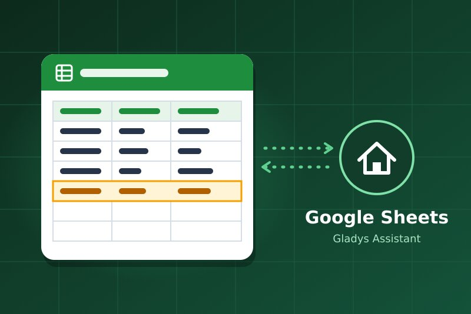
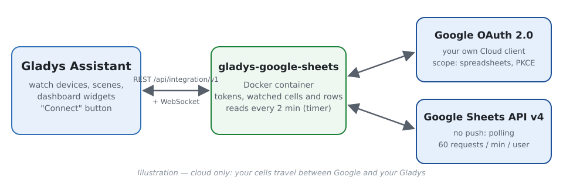
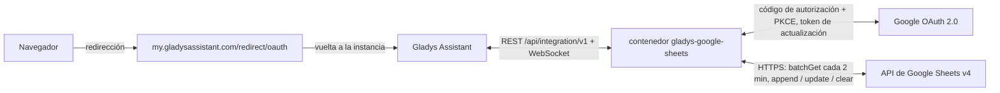
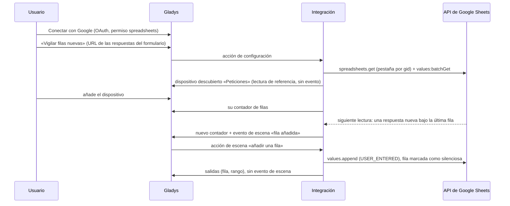
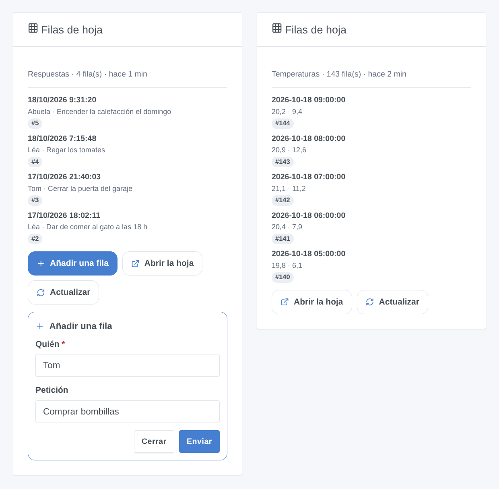

# Gladys Google Sheets

[English](README.md) · [Français](README.fr.md) · [Deutsch](README.de.md) · **Español**

[](LICENSE)
[](https://github.com/William-De71/gladys-google-sheets/releases)
[](https://github.com/William-De71/gladys-google-sheets/actions/workflows/release.yml)
[](https://gladysassistant.com)



Integración externa de [Gladys Assistant](https://gladysassistant.com) para **Google Sheets**: tus escenas añaden filas, escriben, leen y borran celdas de tus hojas de cálculo, y Gladys reacciona a lo que cambia en ellas (una respuesta de Google Forms, un valor escrito en el móvil). Las celdas vigiladas se convierten en dispositivos, y un widget del panel muestra las últimas filas de una pestaña con un formulario para añadir una; usa la API oficial de Google Sheets con tu propio cliente OAuth de Google Cloud.

Documentación de usuario: [English](docs/en.md) · [Français](docs/fr.md) · [Deutsch](docs/de.md) · [Español](docs/es.md).

> Integración comunitaria, no afiliada a Google ni respaldada por Google.

## Funciones

- **4 acciones de escena**: añadir una fila (con fecha y hora si quieres), escribir celdas, leer celdas (valor mostrado, número real, rango completo), borrar celdas, en cualquier hoja que la cuenta pueda editar.
- **Vigilancias** declaradas desde la pantalla de configuración sin JSON, basta con pegar una URL: una **celda** (un dispositivo: número, texto, temperatura, importe o índice de energía) o las **filas nuevas** de una pestaña (un dispositivo: contador de filas).
- **2 activadores de escena**: **celda cambiada** (filtro sobre el nuevo valor) y **fila añadida**, nunca lanzados por los cambios que hace Gladys.
- **1 widget de panel**: las últimas filas de una pestaña vigilada, con un formulario «Añadir una fila» con los nombres del encabezado.
- **OAuth 2.0** con tu propio cliente de Google Cloud: solo el permiso `spreadsheets` (sin Drive), PKCE, estado conservado tras un reinicio, un acceso revocado avisado sin saturar a Google.
- **Cuida la cuota**: una lectura agrupada por hoja cada 2 minutos por defecto, un límite local por debajo de las 60 solicitudes por minuto de Google, espera exponencial ante HTTP 429.
- Cuatro idiomas en todas partes: inglés, francés, alemán, español.

Frente a la integración `google_sheets` de Home Assistant, que solo añade filas desde una automatización, esta también lee, escribe y borra celdas, reacciona a filas nuevas y celdas cambiadas, y expone celdas como dispositivos.

## Funcionamiento







### Transporte

`transports: ["cloud"]`: todo pasa por los servidores de Google; tus datos solo circulan entre Google y tu Gladys. Los dispositivos de las vigilancias llevan la insignia de nube, y una insignia «inaccesible» cuando Google revocó el acceso o la hoja o pestaña vigilada dejó de poder leerse.

## Dispositivos y funciones

| Vigilancia   | Función | Categoría / tipo                                                                                                                                       |
| ------------ | ------- | ------------------------------------------------------------------------------------------------------------------------------------------------------ |
| Una celda    | Valor   | `unknown` / `unknown` (número), `text` / `text`, `temperature-sensor` / `decimal` (°C), `currency` / `decimal` (€, $), `energy-sensor` / `index` (kWh) |
| Filas nuevas | Filas   | `counter-sensor` / `integer`: filas de datos de la pestaña, sin el encabezado                                                                          |

Los dispositivos son de solo lectura (se sigue editando en la hoja) y los lee un temporizador interno (`should_poll: false`). Por qué dispositivos y no solo activadores: un dispositivo ofrece mosaicos, historial y condiciones con umbral («stock por debajo de 5»), que un activador no puede expresar, y permite que los activadores y el widget elijan una vigilancia por su nombre.

## Activadores, acciones de escena y widgets



- Activadores (filtrados por vigilancia): **celda cambiada** (filtrada también por el nuevo valor, variables `value`, `previous_value`, `number`…) y **fila añadida** (variables `row`, `values`, `column_1`…`column_10`).
- Acciones: **añadir una fila**, **escribir celdas**, **leer celdas**, **borrar celdas**; «como si se escribieran» (USER_ENTERED) o «texto sin formato» (RAW). Nunca lanzan una escena a cambio, ni siquiera a través de una fórmula.
- Widget: **Filas de hoja** (de 1 a 8 últimas filas, la más reciente primero, detalle por nombre de encabezado, Añadir una fila / Abrir la hoja / Actualizar).
- Ejemplos: registrar las temperaturas cada hora; avisar al hogar de cada respuesta de Google Forms; leer una temperatura objetivo guardada en una pestaña «Ajustes»; apagar una luz de aviso cuando alguien escribe «Hecho» en una celda.

No implementado: un widget para las celdas vigiladas (son dispositivos, el panel ya los muestra), las notificaciones push de Drive (un webhook público y el permiso de Drive, mucho más amplio), el formato, la creación de hojas o pestañas, la escritura de varias filas a la vez.

## Requisitos

- Gladys **5.2.0** o posterior (las versiones anteriores no pueden instalar la integración: formularios de widget, widgets y escenas).
- Una cuenta de Google y las hojas que quieras usar (tuyas o compartidas contigo).
- Un proyecto gratuito de Google Cloud con la API de Google Sheets habilitada, una pantalla de consentimiento **En producción** y un cliente OAuth de tipo **Aplicación web** cuyo URI de redireccionamiento sea `https://my.gladysassistant.com/redirect/oauth` (paso a paso en la [documentación](docs/es.md#configuración)).

## Instalación

- **Desde la tienda**: Integraciones → Google Sheets → Instalar.
- **Desde la URL del repositorio**: Integraciones → Añadir una integración externa → `https://github.com/William-De71/gladys-google-sheets`.
- **Modo desarrollador**: `npm install` y luego ejecútala junto a un Gladys en modo desarrollador con las variables de abajo.

## Configuración

| Campo                               | Por defecto | Función                                                                  |
| ----------------------------------- | ----------- | ------------------------------------------------------------------------ |
| Client ID                           | —           | Tu cliente OAuth (`….apps.googleusercontent.com`)                        |
| Client secret                       | —           | Su secreto (`GOCSPX-…`)                                                  |
| Conectar con Google                 | —           | Conexión OAuth 2.0 (solo el permiso `spreadsheets`)                      |
| Hoja de cálculo predeterminada      | —           | URL o ID usado cuando una acción, vigilancia o el widget no indican otra |
| Leer las vigilancias cada (minutos) | 2           | 1 a 60; 2 o 3 solicitudes por hoja vigilada                              |
| Idioma de los textos                | Automático  | Nombres de las funciones, mensajes de los botones                        |

Acciones de configuración: **Vigilar una celda**, **Vigilar filas nuevas**, **Eliminar una vigilancia**, **Listar las vigilancias**, **Probar la conexión**, **Diagnóstico** (un resumen anonimizado en los registros), **Desconectar de Google** (revoca el acceso en Google).

## Uso

Guarda el Client ID y el secreto, pulsa **Conectar con Google**, acepta el aviso de «aplicación sin verificar» (es la tuya) y marca el permiso de Sheets. Las acciones de escena funcionan enseguida; declara vigilancias con los botones de configuración, luego añade sus dispositivos desde el **descubrimiento** y el widget a un panel.

## Desarrollo

```bash
npm install
npm test                     # node --test, nunca accede a la red
npm run lint && npm run format:check
npx github:GladysAssistant/integration-store . --skip-image-check
docs/illustrations/render.sh # ilustraciones del widget
scripts/build-cover.sh       # cover.jpg
```

Variables de entorno (las define el supervisor de Gladys): `GLADYS_HOST_API_URL`, `GLADYS_INTEGRATION_TOKEN`, `GLADYS_INTEGRATION_SELECTOR` y `TZ` (la zona horaria de Gladys: la fecha y la hora escritas en las filas). La integración no escribe nada en `/data`: los tokens y las vigilancias viven en la configuración de Gladys. Las llamadas a Google pasan solo por `src/sheets-api.js`, simulado en las pruebas (`test/helpers/fakes.js`).

## Proceso de publicación


Cada fusión en `main` ejecuta la CI y calcula la versión a partir de los [Conventional Commits](https://www.conventionalcommits.org/) desde la última etiqueta: `feat` → menor, `fix` / `perf` → parche, `!` o `BREAKING CHANGE` → mayor (una menor por debajo de 1.0.0); `docs`, `chore`, `ci`, `test`, `style`, `refactor`, `build` solos no publican nada. Sin etiqueta, la 0.1.0 se publica tal cual. Se genera la sección del changelog, se sube la etiqueta, se construye la imagen multiarquitectura, luego `main` recibe el commit de publicación (así la tienda nunca ve una versión sin su imagen), se crea la GitHub Release y un último job comprueba la imagen pública, el validador de la tienda y el topic.

- El título de la pull request se convierte en el commit squash y luego en la línea del changelog: escríbelo en inglés, para el usuario (`pr-title.yml` lo comprueba). No edites nunca `CHANGELOG.md` a mano.
- La 1.0.0 es una decisión: Actions → Release → Run workflow con `release-as: 1.0.0`. `dry-run` muestra la versión y las notas sin publicar nada.
- **Rama protegida**: la publicación sube su commit a `main` con `GITHUB_TOKEN`. Con un ruleset que exija pull requests o status checks en `main`, añade GitHub Actions a su lista de excepciones (o sube mediante una GitHub App), si no el job de publicación falla. El ruleset `protect-main` (sin borrado ni force push) lo deja pasar.
- Tras la primera publicación, el paquete `ghcr.io` debe ser público (Package settings → Change visibility).

## Solución de problemas

Consulta [docs/es.md](docs/es.md#solución-de-problemas) (URI de redireccionamiento distinta, app en prueba, permiso no marcado, API no habilitada, hoja rechazada, cuota). Informa de los problemas con las versiones de Gladys y de la integración, tu configuración de Google Cloud y la salida del botón **Diagnóstico** (Ajustes → Supervisión).

## Contribuir

Las issues y pull requests son bienvenidas. Ejecuta `npm run format:check && npm run lint && npm test` antes de abrir una pull request y no cambies ningún external id ni ninguna clave guardada (ver [CLAUDE.md](CLAUDE.md)).

## Seguridad

Consulta [SECURITY.md](SECURITY.md): informa de las vulnerabilidades en privado. El Client secret es un campo `secret`; los tokens viven en la configuración de Gladys (fuera del formulario) y nunca se registran; la acción Diagnóstico no escribe tokens, valores de celda ni nombres de hoja. Con valores «como si se escribieran», un texto que empieza por `=` se convierte en fórmula: elige «texto sin formato» para un texto que viene de fuera de Gladys.

## Capturas pendientes

Las imágenes de arriba son ilustraciones, no capturas de pantalla. Las capturas reales irán en `docs/assets/screenshots/` (PNG, 1280 × 800): `configuration.png`, `watch-cell-form.png`, `google-consent.png`, `discovery.png`, `device.png`, `scene-append-row.png`.

## Licencia

[Licencia Apache 2.0](LICENSE) — ver también [NOTICE](NOTICE). Google Sheets es una marca de Google LLC; esta integración comunitaria no está afiliada a ella. Gracias a la documentación y al SDK de Gladys.
