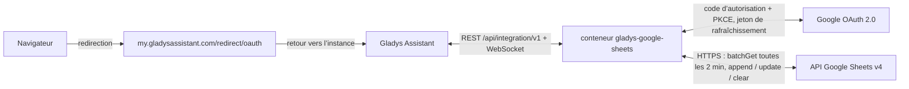
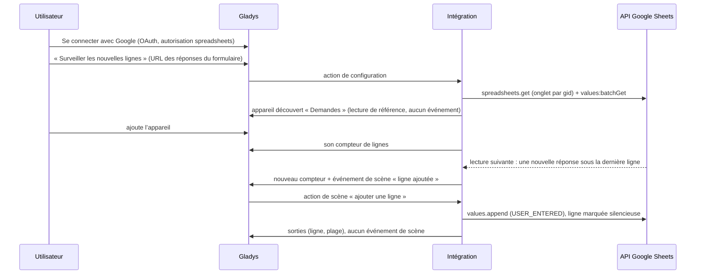
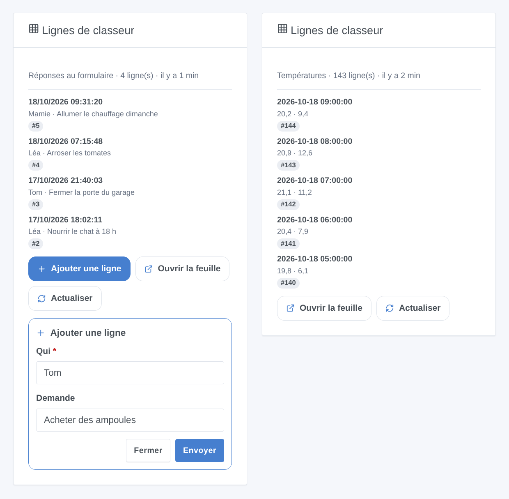

# Gladys Google Sheets

[English](README.md) · **Français** · [Deutsch](README.de.md) · [Español](README.es.md)

[](LICENSE)
[](https://github.com/William-De71/gladys-google-sheets/releases)
[](https://github.com/William-De71/gladys-google-sheets/actions/workflows/release.yml)
[](https://gladysassistant.com)


Intégration externe [Gladys Assistant](https://gladysassistant.com) pour **Google Sheets** : vos scènes ajoutent des lignes, écrivent, lisent et effacent des cellules de vos classeurs, et Gladys réagit à ce qui y change (une réponse Google Forms, une valeur saisie sur le téléphone). Les cellules surveillées deviennent des appareils, et un widget de tableau de bord affiche les dernières lignes d’un onglet avec un formulaire pour en ajouter ; elle utilise l’API officielle Google Sheets avec votre propre client OAuth Google Cloud.

Documentation utilisateur : [English](docs/en.md) · [Français](docs/fr.md) · [Deutsch](docs/de.md) · [Español](docs/es.md).

> Intégration communautaire, ni affiliée à Google ni approuvée par Google.

## Fonctionnalités

- **4 actions de scène** : ajouter une ligne (horodatée si besoin), écrire des cellules, lire des cellules (valeur affichée, nombre réel, plage entière), effacer des cellules, sur tout classeur que le compte peut modifier.
- **Surveillances** déclarées depuis l’écran de configuration sans JSON, une URL collée suffit : une **cellule** (un appareil : nombre, texte, température, montant ou index d’énergie) ou les **nouvelles lignes** d’un onglet (un appareil : compteur de lignes).
- **2 déclencheurs de scène** : **cellule modifiée** (filtre sur la nouvelle valeur) et **ligne ajoutée**, jamais levés par les changements que fait Gladys elle-même.
- **1 widget de tableau de bord** : les dernières lignes d’un onglet surveillé, avec un formulaire « Ajouter une ligne » aux noms de l’en-tête.
- **OAuth 2.0** avec votre propre client Google Cloud : seule l’autorisation `spreadsheets` (pas de Drive), PKCE, état conservé à travers un redémarrage, accès révoqué signalé sans harceler Google.
- **Économe en quota** : une lecture groupée par classeur toutes les 2 minutes par défaut, une limite locale sous les 60 requêtes par minute de Google, attente exponentielle sur HTTP 429.
- Quatre langues partout : anglais, français, allemand, espagnol.

Par rapport à l’intégration `google_sheets` de Home Assistant, qui ne fait qu’ajouter des lignes depuis une automatisation, celle-ci lit, écrit et efface aussi des cellules, réagit aux nouvelles lignes et aux cellules modifiées, et expose des cellules comme appareils.

## Fonctionnement






### Transport

`transports: ["cloud"]` : tout passe par les serveurs de Google ; vos données ne circulent qu’entre Google et votre Gladys. Les appareils des surveillances portent le badge cloud, et un badge « injoignable » quand Google a révoqué l’accès ou que le classeur ou l’onglet surveillé est devenu illisible.

## Appareils et fonctionnalités

| Surveillance     | Fonctionnalité | Catégorie / type                                                                                                                                       |
| ---------------- | -------------- | ------------------------------------------------------------------------------------------------------------------------------------------------------ |
| Une cellule      | Valeur         | `unknown` / `unknown` (nombre), `text` / `text`, `temperature-sensor` / `decimal` (°C), `currency` / `decimal` (€, $), `energy-sensor` / `index` (kWh) |
| Nouvelles lignes | Lignes         | `counter-sensor` / `integer` : lignes de données de l’onglet, en-tête exclu                                                                            |

Les appareils sont en lecture seule (la feuille reste l’endroit où l’on modifie), lus par un minuteur interne (`should_poll: false`). Pourquoi des appareils et pas seulement des déclencheurs : un appareil donne tuiles, historique et conditions à seuil (« stock sous 5 »), qu’un déclencheur ne sait pas exprimer, et permet aux déclencheurs et au widget de choisir une surveillance par son nom.

## Déclencheurs, actions de scène et widgets



- Déclencheurs (filtrés par surveillance) : **cellule modifiée** (filtrée aussi par la nouvelle valeur, variables `value`, `previous_value`, `number`…) et **ligne ajoutée** (variables `row`, `values`, `column_1`…`column_10`).
- Actions : **ajouter une ligne**, **écrire des cellules**, **lire des cellules**, **effacer des cellules** ; « comme saisies » (USER_ENTERED) ou « texte brut » (RAW). Elles ne lancent jamais de scène en retour, même à travers une formule.
- Widget : **Lignes de classeur** (1 à 8 dernières lignes, la plus récente en premier, détail par nom d’en-tête, Ajouter une ligne / Ouvrir la feuille / Actualiser).
- Exemples : journaliser les températures toutes les heures ; prévenir le foyer à chaque réponse Google Forms ; lire une consigne rangée dans un onglet « Réglages » ; éteindre un voyant de rappel quand quelqu’un tape « Fait » dans une cellule.

Non implémenté : un widget pour les cellules surveillées (ce sont des appareils, le tableau de bord les affiche déjà), les notifications push de Drive (un webhook public et l’autorisation Drive bien plus large), la mise en forme, la création de classeurs ou d’onglets, l’écriture de plusieurs lignes d’un coup.

## Prérequis

- Gladys **5.2.0** ou plus récent (les versions antérieures ne peuvent pas installer l’intégration : formulaires de widget, widgets et scènes).
- Un compte Google et les classeurs à utiliser (les vôtres ou partagés avec vous).
- Un projet Google Cloud gratuit avec l’API Google Sheets activée, un écran de consentement **En production** et un client OAuth de type **Application Web** dont l’URI de redirection est `https://my.gladysassistant.com/redirect/oauth` (pas à pas dans la [documentation](docs/fr.md#configuration)).

## Installation

- **Depuis le store** : Intégrations → Google Sheets → Installer.
- **Depuis l’URL du dépôt** : Intégrations → Ajouter une intégration externe → `https://github.com/William-De71/gladys-google-sheets`.
- **Mode développeur** : `npm install`, puis lancez-la à côté d’un Gladys en mode développeur avec les variables ci-dessous.

## Configuration

| Champ                                         | Défaut      | Rôle                                                                                 |
| --------------------------------------------- | ----------- | ------------------------------------------------------------------------------------ |
| Client ID                                     | —           | Votre client OAuth (`….apps.googleusercontent.com`)                                  |
| Client secret                                 | —           | Son secret (`GOCSPX-…`)                                                              |
| Se connecter avec Google                      | —           | Connexion OAuth 2.0 (autorisation `spreadsheets` seule)                              |
| Classeur par défaut                           | —           | URL ou identifiant utilisé quand une action, surveillance ou widget n’en indique pas |
| Relire les surveillances toutes les (minutes) | 2           | 1 à 60 ; 2 ou 3 requêtes par classeur surveillé                                      |
| Langue des textes                             | Automatique | Noms des fonctionnalités, messages des boutons                                       |

Actions de configuration : **Surveiller une cellule**, **Surveiller les nouvelles lignes**, **Supprimer une surveillance**, **Lister les surveillances**, **Tester la connexion**, **Diagnostic** (un résumé anonymisé dans les journaux), **Se déconnecter de Google** (révoque l’accès chez Google).

## Utilisation

Enregistrez le Client ID et le secret, cliquez sur **Se connecter avec Google**, acceptez l’avertissement « application non validée » (c’est la vôtre) et cochez l’autorisation Sheets. Les actions de scène fonctionnent aussitôt ; déclarez des surveillances avec les boutons de configuration, puis ajoutez leurs appareils depuis la **découverte** et le widget à un tableau de bord.

## Développement

```bash
npm install
npm test                     # node --test, ne touche jamais le réseau
npm run lint && npm run format:check
npx github:GladysAssistant/integration-store . --skip-image-check
docs/illustrations/render.sh # illustrations du widget
scripts/build-cover.sh       # cover.jpg
```

Variables d’environnement (fournies par le superviseur de Gladys) : `GLADYS_HOST_API_URL`, `GLADYS_INTEGRATION_TOKEN`, `GLADYS_INTEGRATION_SELECTOR`, et `TZ` (le fuseau horaire de Gladys : la date et l’heure écrites dans les lignes). L’intégration n’écrit rien dans `/data` : les jetons et les surveillances vivent dans la configuration de Gladys. Les appels à Google passent uniquement par `src/sheets-api.js`, simulé dans les tests (`test/helpers/fakes.js`).

## Processus de release


Chaque fusion sur `main` lance la CI, puis calcule la version à partir des [Conventional Commits](https://www.conventionalcommits.org/) depuis le dernier tag : `feat` → mineure, `fix` / `perf` → correctif, `!` ou `BREAKING CHANGE` → majeure (une mineure sous 1.0.0) ; `docs`, `chore`, `ci`, `test`, `style`, `refactor`, `build` seuls ne publient rien. Sans tag, la 0.1.0 est publiée telle quelle. La section du changelog est générée, le tag poussé, l’image multi-architecture construite, puis `main` reçoit le commit de release (le store ne voit donc jamais une version sans son image), la GitHub Release est créée et un dernier job vérifie l’image publique, le validateur du store et le topic.

- Le titre de la pull request devient le commit squash, puis la ligne du changelog : écrivez-le en anglais, pour l’utilisateur (`pr-title.yml` le vérifie). Ne modifiez jamais `CHANGELOG.md` à la main.
- La 1.0.0 est une décision : Actions → Release → Run workflow avec `release-as: 1.0.0`. `dry-run` affiche la version et les notes sans rien publier.
- **Branche protégée** : la release pousse son commit sur `main` avec `GITHUB_TOKEN`. Avec un ruleset exigeant des pull requests ou des status checks sur `main`, ajoutez GitHub Actions à sa liste de contournement (ou poussez via une GitHub App), sinon le job de publication échoue. Le ruleset `protect-main` (ni suppression ni force-push) le laisse passer.
- Après la première release, le package `ghcr.io` doit être public (Package settings → Change visibility).

## Dépannage

Voir [docs/fr.md](docs/fr.md#dépannage) (URI de redirection différente, application restée en test, autorisation non cochée, API non activée, classeur refusé, quota). Signalez un problème avec les versions de Gladys et de l’intégration, votre configuration Google Cloud et la sortie du bouton **Diagnostic** (Paramètres → Supervision).

## Contribuer

Les issues et pull requests sont les bienvenues. Lancez `npm run format:check && npm run lint && npm test` avant d’ouvrir une pull request, et ne changez aucun external id ni aucune clé stockée (voir [CLAUDE.md](CLAUDE.md)).

## Sécurité

Voir [SECURITY.md](SECURITY.md) : signalez les vulnérabilités en privé. Le Client secret est un champ `secret` ; les jetons vivent dans la configuration de Gladys (hors du formulaire) et ne sont jamais journalisés ; l’action Diagnostic n’écrit ni jeton, ni valeur de cellule, ni nom de feuille. Avec des valeurs « comme saisies », un texte qui commence par `=` devient une formule : choisissez « texte brut » pour un texte venu de l’extérieur de Gladys.

## Captures à venir

Les images ci-dessus sont des illustrations, pas des captures d’écran. Les vraies captures iront dans `docs/assets/screenshots/` (PNG, 1280 × 800) : `configuration.png`, `watch-cell-form.png`, `google-consent.png`, `discovery.png`, `device.png`, `scene-append-row.png`.

## Licence

[Licence Apache 2.0](LICENSE) — voir aussi [NOTICE](NOTICE). Google Sheets est une marque de Google LLC ; cette intégration communautaire n’y est pas affiliée. Merci à la documentation et au SDK de Gladys.
