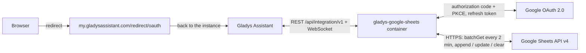
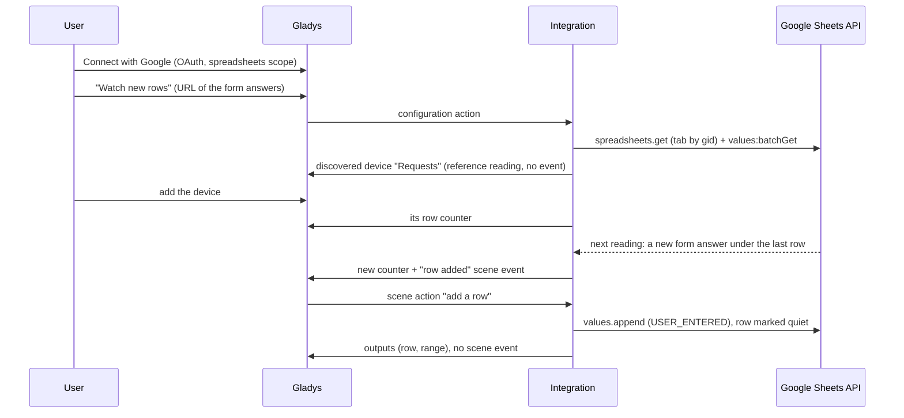
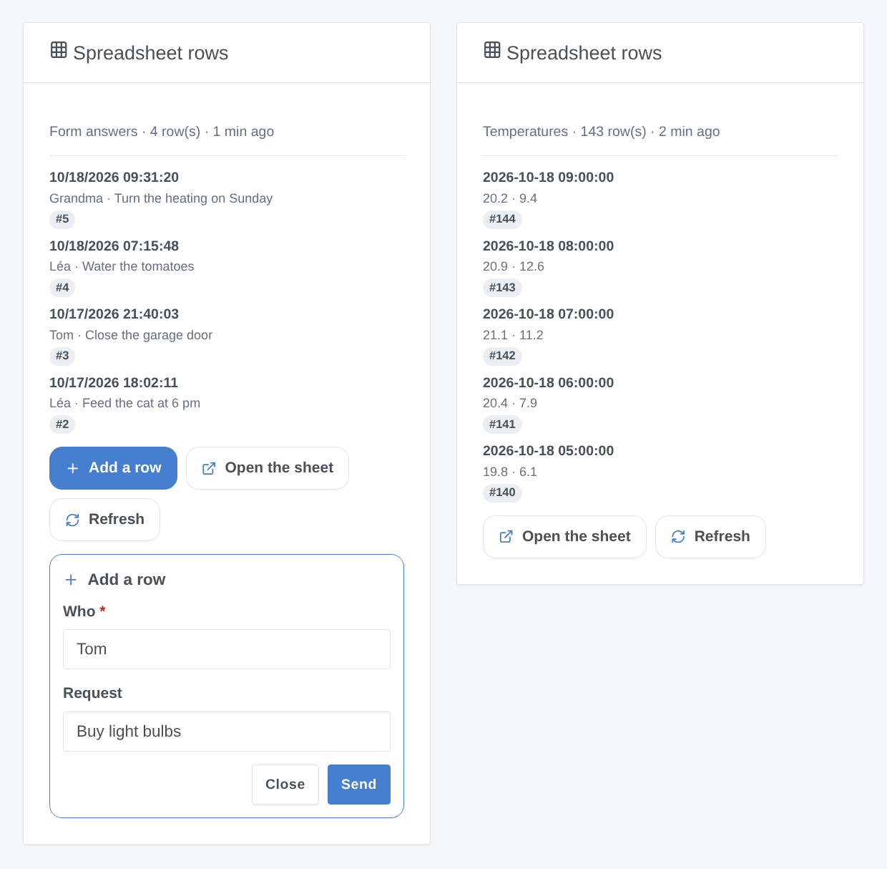

# Gladys Google Sheets

**English** · [Français](README.fr.md) · [Deutsch](README.de.md) · [Español](README.es.md)

[](LICENSE)
[](https://github.com/William-De71/gladys-google-sheets/releases)
[](https://github.com/William-De71/gladys-google-sheets/actions/workflows/release.yml)
[](https://gladysassistant.com)


[Gladys Assistant](https://gladysassistant.com) external integration for **Google Sheets**: your scenes add rows, write, read and clear cells of your spreadsheets, and Gladys reacts to what changes in them (a Google Forms answer, a value typed on the phone). Watched cells become devices, and a dashboard widget shows the last rows of a tab with a form to add one; it uses the official Google Sheets API with your own Google Cloud OAuth client.

User documentation: [English](docs/en.md) · [Français](docs/fr.md) · [Deutsch](docs/de.md) · [Español](docs/es.md).

> Community integration, not affiliated with nor endorsed by Google.

## Features

- **4 scene actions**: add a row (optionally time-stamped), write cells, read cells (value as shown, real number, whole range), clear cells, on any spreadsheet the account can edit.
- **Watches** declared from the configuration screen without JSON, a pasted URL being enough: a **cell** (a device: number, text, temperature, amount or energy index) or the **new rows** of a tab (a device: row counter).
- **2 scene triggers**: **cell changed** (filter by the new value) and **row added**, never raised by the changes Gladys makes itself.
- **1 dashboard widget**: the last rows of a watched tab, with an "Add a row" form named after the header.
- **OAuth 2.0** with your own Google Cloud client: `spreadsheets` scope only (no Drive), PKCE, state kept across a restart, a revoked access reported without hammering Google.
- **Quota-friendly**: one batched reading per spreadsheet every 2 minutes by default, a local limit under the 60 requests a minute of Google, exponential backoff on HTTP 429.
- Four languages everywhere: English, French, German, Spanish.

Compared with the Home Assistant `google_sheets` integration, which only appends rows from an automation, this one also reads, writes and clears cells, reacts to new rows and changed cells, and exposes cells as devices.

## How it works






### Transport

`transports: ["cloud"]`: everything goes through Google's servers; your data travels between Google and your Gladys only. The watch devices carry the cloud badge, and an "unreachable" badge once Google revoked the access or the watched spreadsheet or tab became unreadable.

## Devices and features

| Watch    | Feature | Category / type                                                                                                                                        |
| -------- | ------- | ------------------------------------------------------------------------------------------------------------------------------------------------------ |
| A cell   | Value   | `unknown` / `unknown` (number), `text` / `text`, `temperature-sensor` / `decimal` (°C), `currency` / `decimal` (€, $), `energy-sensor` / `index` (kWh) |
| New rows | Rows    | `counter-sensor` / `integer`: data rows of the tab, header excluded                                                                                    |

The devices are read-only (the sheet stays the place to edit), polled by an internal timer (`should_poll: false`). Why devices and not only triggers: a device gives tiles, history and threshold conditions ("stock below 5"), which a trigger cannot express, and lets the triggers and the widget pick a watch by name.

## Scene triggers, actions and widgets



- Triggers (filtered by watch): **cell changed** (also filtered by the new value, variables `value`, `previous_value`, `number`…) and **row added** (variables `row`, `values`, `column_1`…`column_10`).
- Actions: **add a row**, **write cells**, **read cells**, **clear cells**; "as if typed" (USER_ENTERED) or "raw text" (RAW). They never start a scene in return, even through a formula.
- Widget: **Spreadsheet rows** (last 1 to 8 rows, newest first, details by header name, Add a row / Open the sheet / Refresh).
- Examples: log the temperatures every hour; notify the household of each Google Forms answer; read a set-point stored in a "Settings" tab; turn a reminder light off when someone types "Done" in a cell.

Not implemented: a widget for the watched cells (they are devices, the dashboard already shows them), Drive push notifications (a public webhook and the much wider Drive scope), formatting, creating spreadsheets or tabs, writing several rows at once.

## Requirements

- Gladys **5.3.0** or later (older versions cannot install the integration: widget forms, widgets and scenes, catalog keywords of Gladys 5.3).
- A Google account and the spreadsheets to use (yours or shared with you).
- A free Google Cloud project with the Google Sheets API enabled, a consent screen **In production** and an OAuth client of type **Web application** whose redirect URI is `https://my.gladysassistant.com/redirect/oauth` (step by step in the [documentation](docs/en.md#configuration)).

## Installation

- **From the store**: Integrations → Google Sheets → Install.
- **From the repository URL**: Integrations → Add an external integration → `https://github.com/William-De71/gladys-google-sheets`.
- **Developer mode**: `npm install`, then run it next to a Gladys in developer mode with the variables below.

## Configuration

| Field                            | Default   | Purpose                                                   |
| -------------------------------- | --------- | --------------------------------------------------------- |
| Client ID                        | —         | Your OAuth client (`….apps.googleusercontent.com`)        |
| Client secret                    | —         | Its secret (`GOCSPX-…`)                                   |
| Connect with Google              | —         | OAuth 2.0 sign-in (`spreadsheets` scope only)             |
| Default spreadsheet              | —         | URL or ID used when an action, watch or widget names none |
| Read the watches every (minutes) | 2         | 1 to 60; 2 or 3 requests per watched spreadsheet          |
| Language of the texts            | Automatic | Feature names, messages of the buttons                    |

Configuration actions: **Watch a cell**, **Watch new rows**, **Remove a watch**, **List the watches**, **Test the connection**, **Diagnostic** (an anonymized summary in the logs), **Disconnect from Google** (revokes the access at Google).

## Usage

Save the Client ID and secret, click **Connect with Google**, accept the "unverified app" warning (it is your own app) and tick the Sheets permission. The scene actions work right away; declare watches with the configuration buttons, then add their devices from **Discovery** and the widget to a dashboard.

## Development

```bash
npm install
npm test                     # node --test, never touches the network
npm run lint && npm run format:check
npx github:GladysAssistant/integration-store . --skip-image-check
docs/illustrations/render.sh # widget illustrations
scripts/build-cover.sh       # cover.jpg
```

Environment variables (set by the Gladys supervisor): `GLADYS_HOST_API_URL`, `GLADYS_INTEGRATION_TOKEN`, `GLADYS_INTEGRATION_SELECTOR`, and `TZ` (the time zone of Gladys: the date and time written in the rows). The integration writes nothing to `/data`: the tokens and the watches live in the Gladys configuration. The Google calls go through `src/sheets-api.js` only, mocked in the tests (`test/helpers/fakes.js`).

## Release process


Every merge on `main` runs the CI, then computes the version from the [Conventional Commits](https://www.conventionalcommits.org/) since the last tag: `feat` → minor, `fix` / `perf` → patch, `!` or `BREAKING CHANGE` → major (a minor below 1.0.0); `docs`, `chore`, `ci`, `test`, `style`, `refactor`, `build` alone publish nothing. With no tag yet, 0.1.0 is released as is. The changelog section is generated, the tag pushed, the multi-architecture image built, then `main` receives the release commit (so the store never sees a version without its image), the GitHub Release is created and a last job checks the public image, the store validator and the topic.

- The pull request title becomes the squash commit, then the changelog line: write it in English, for the user (`pr-title.yml` checks it). Never edit `CHANGELOG.md` by hand.
- 1.0.0 is a decision: Actions → Release → Run workflow with `release-as: 1.0.0`. `dry-run` shows the version and the notes without publishing.
- **Protected branch**: the release pushes its commit to `main` with `GITHUB_TOKEN`. With a ruleset requiring pull requests or status checks on `main`, add GitHub Actions to its bypass list (or push through a GitHub App), otherwise the publish job fails. The `protect-main` ruleset (no deletion, no force push) lets it through.
- After the first release, the `ghcr.io` package must be public (Package settings → Change visibility).

## Troubleshooting

See [docs/en.md](docs/en.md#troubleshooting) (redirect URI mismatch, app left in Testing, permission not ticked, API not enabled, spreadsheet refused, quota). Report issues with the versions of Gladys and of the integration, your Google Cloud setup, and the output of the **Diagnostic** button (Settings → Supervision).

## Contributing

Issues and pull requests are welcome. Run `npm run format:check && npm run lint && npm test` before opening a pull request, and keep every external id and stored key unchanged (see [CLAUDE.md](CLAUDE.md)).

## Security

See [SECURITY.md](SECURITY.md): report vulnerabilities privately. The Client secret is a `secret` field; the tokens live in the Gladys configuration (outside the form) and are never logged; the Diagnostic action writes neither tokens, nor cell values, nor sheet names. With "as if typed" values, a text starting with `=` becomes a formula: choose "raw text" for text coming from outside Gladys.

## Screenshots to come

The images above are illustrations, not screenshots. Real screenshots will go in `docs/assets/screenshots/` (PNG, 1280 × 800): `configuration.png`, `watch-cell-form.png`, `google-consent.png`, `discovery.png`, `device.png`, `scene-append-row.png`.

## License

[Apache License 2.0](LICENSE) — see also [NOTICE](NOTICE). Google Sheets is a trademark of Google LLC; this community integration is not affiliated with it. Thanks to the Gladys documentation and SDK.
